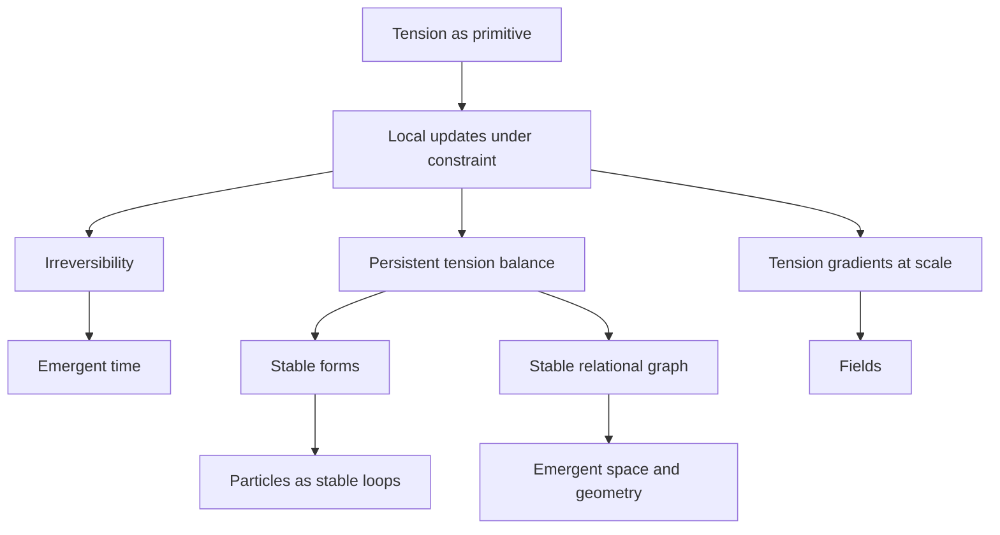

# Tension Theory

**A foundational framework where tension — constrained informational difference — is the pre-mathematical primitive, and time, space, causality, particles, and fields emerge from finite-memory local updates on a dynamic graph.**

Version 0.1 · [Zenodo DOI: 10.5281/zenodo.20420283](https://doi.org/10.5281/zenodo.20420283) · CC BY 4.0 · Author: Roybos Nine

---

## The claim

The universe is not made of objects on a background. There is no background. There are only local states, relations between them, and a single quantity governing how they change: **tension**.

When relations operate under constraint — finite memory, local access, non-zero update cost — tension appears. When tension is reduced locally, stable correlations persist. Persistent correlations are what we call structure. Geometry is not fundamental: it is the most efficient persistent summary of relational structure.

From this, the framework derives its canonical compressions:

| Emergent quantity | Definition in TT |
|---|---|
| Time | Ordered irreversibility |
| Space | Stable relational graph |
| Causality | Dependency under locality and cost |
| Particle | Stable tension loop |
| Field | Large-scale tension gradient |
| Probability | Incomplete local knowledge |
| Observation | Constrained coupling |



## The ten postulates

The entire framework rests on ten postulates and nothing else — no assumptions about continuity, probability, or geometry:

1. **Finite Memory** — no global, lossless, or infinite memory exists.
2. **Local State** — no system has access to global configuration, only adjacent states.
3. **Cost of Update** — every state transition has non-zero cost, expressed as tension.
4. **Tension as Primitive** — tension is the fundamental quantity governing evolution.
5. **Discrete Updates** — continuity is an emergent approximation.
6. **Irreversibility** — perfect reversibility requires infinite memory and is excluded.
7. **Relational Structure** — no absolute space; structure arises from relations and persistent gradients.
8. **Emergent Time** — time is the ordering of irreversible updates under finite memory.
9. **Observation as Coupling** — no external observer, no special measurement rule.
10. **Stability via Constraint** — persistent forms are configurations where gradients locally balance.

## What this is not

**Not metaphor.** The objective is formalization. If the model is wrong, it should fail mathematically. If it is correct, it should produce testable differences from existing frameworks. Validity here means executable prediction, not elegance.

**Not a cellular automaton.** CAs run fixed rules on a fixed lattice with a global clock. TT graphs have dynamic, cost-aware topology, no global tape, and no global synchronization requirement.

**Not finished.** Version 0.1 establishes structural emergence. The quantitative mapping to known physics is the open program, and the line between the two is kept explicit throughout.

## Simulator

`scripts/tension_graph.py` is not in this repository. The lattice rule from the author's Notion note *Tension Game of Life v0.1* (status: Idea) is implemented in `sim/`.

```bash
python -m sim --seed 0
python -m sim.figure
```

`python -m sim --seed 0` writes a CSV of mean tension, mean of `T`, and std of `T` at each step, plus PNGs of the final grid and of mean tension against step. Parameters, including choices the note does not specify, are in `docs/PARAMETERS.md`.

## Result of rule v0.1

This is a property of this rule, not a physical prediction.

The note's linear response `f(Δ) = Δ`, with `α = 0.2` on a 100×100 periodic Moore grid and a uniform initial field, homogenizes the grid. Mean tension — the mean of `|T_i − T_j|` over Moore neighbour pairs — falls by about three orders of magnitude in 1000 steps, and the final field is nearly flat. Synchronous updates and asynchronous random-order sweeps do the same thing. The asynchronous sweep reduces mean tension a little faster. Neither run produces oscillating forms or frozen spatial structure.

Mean tension for linear `f`:

| run | t = 0 | t = 100 | t = 1000 |
|---|---:|---:|---:|
| sync, seed 0 | 0.336934 | 0.003639 | 0.000399 |
| sync, seed 1 | 0.334166 | 0.003578 | 0.000451 |
| async, seed 0 | 0.336934 | 0.003307 | 0.000354 |
| async, seed 1 | 0.334166 | 0.003244 | 0.000407 |

Seed 0, synchronous: std of `T` goes from 0.2891 to 0.005673, and the mean of `T` stays 0.499411. The figure below is the same four runs on log-log axes.


## Open problems

In priority order:

1. **Formal specification of τ.** The tension function must be local, respect finite memory, and reproduce known limits when coarse-grained. Any candidate must pass all three conditions and run in the reference implementation before being considered serious.
2. **Quantitative, falsifiable predictions.** Structural emergence is established; numbers are not. This is the standard the framework holds itself to.
3. **Bell inequality violations.** TT's stored-correlations account of entanglement faces genuine pressure from Bell. This is treated as a live threat to the framework, not a solved issue.
4. **Emergence thresholds.** At what graph sizes and constraint regimes do stable forms reliably appear?

## Interpretive extensions (beyond the v0.1 core)

The following are directions beyond the statements above:

- **Quantum uncertainty** as underconstrained relational states prior to stabilization.
- **Black holes** as extreme relational compression limiting outward propagation of structure.
- **Consciousness** as a local recursive loop of the system observing and constraining itself — the same update dynamics, coupled to themselves.

These are conceptual, not derived. They become claims only when they produce calculations.

## Repository contents

- `sim/` — lattice rule from the Notion note *Tension Game of Life v0.1*
- `docs/PARAMETERS.md` — parameters of that rule, including choices the note does not specify
- `docs/figures/mean_tension_sync_vs_async.png` — mean tension, sync vs async, seeds 0 and 1
- `tests/` — pytest suite
- `index.html` — bundled site
- `Tension_Theory_The_Theory_of_Everything_-_Paper_v0.1.pdf` — PDF file stored in the repo

## Contributing

The framework wants to be stress-tested, not flattered. The most valuable contributions are: candidate τ functions that pass the three conditions, simulator experiments that measure emergence thresholds, and rigorous objections — especially around Bell locality.

## Citation

```
Roybos Nine (2026). Tension Theory v0.1. Zenodo.
https://doi.org/10.5281/zenodo.20420283
```

Licensed under CC BY 4.0.

If the model is wrong, it should fail mathematically.
If it is correct, it should produce testable differences from existing frameworks.

This is an open attempt to derive physics, geometry, and observers from a single principle:
Self-referential information optimizing under constraint.
