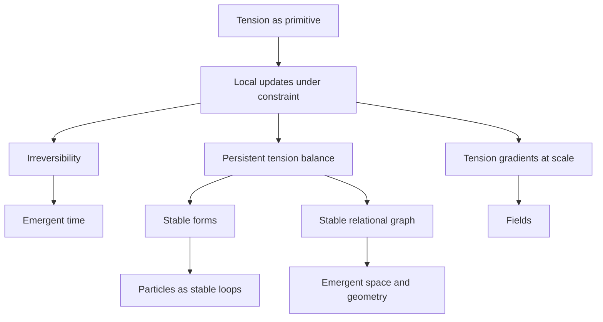
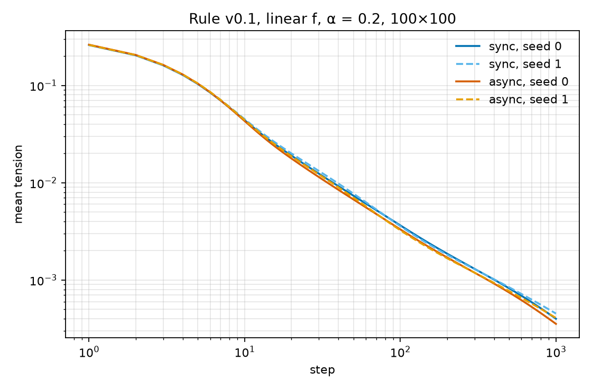
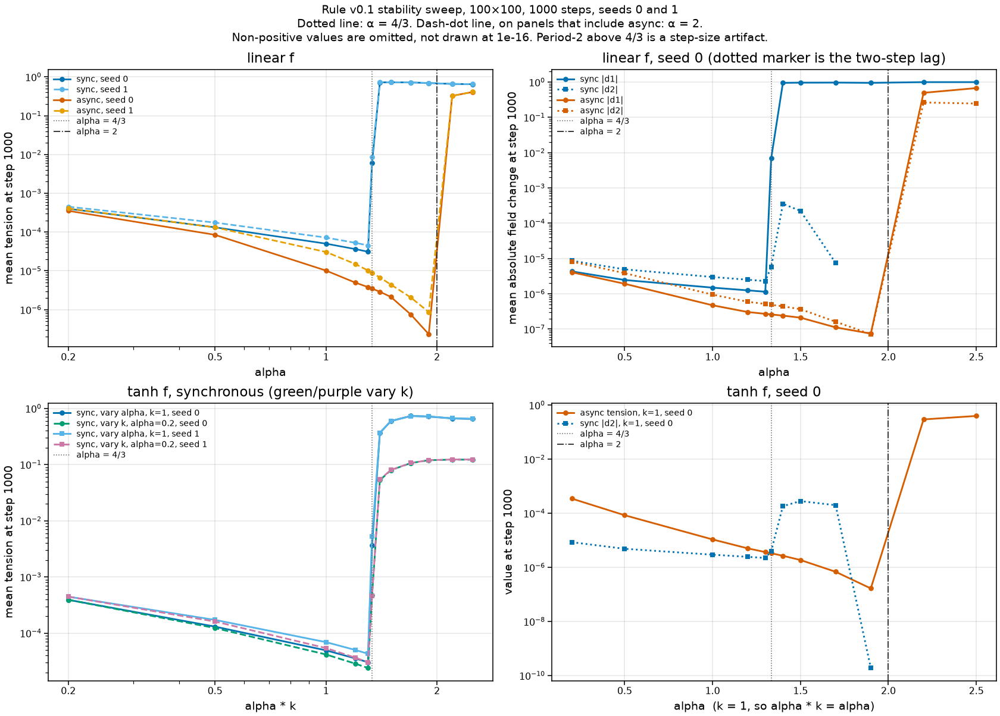

# Tension Theory

**A foundational framework where tension — constrained informational difference — is the pre-mathematical primitive, and time, space, causality, particles, and fields emerge from finite-memory local updates on a dynamic graph.**

Version 0.1 · [Zenodo DOI: 10.5281/zenodo.20420283](https://doi.org/10.5281/zenodo.20420283) · CC BY 4.0 · Author: Roybos Nine

**Not validated by Roybos** (sin validar por Roybos). The version line above is unvalidated v0.1 text. It is not a result of rule v0.1.

---

## The claim

The universe is not made of objects on a background. There is no background. There are only local states, relations between them, and a single quantity governing how they change: **tension**.

**Not validated by Roybos** (sin validar por Roybos). The text from "When relations operate..." through the emergent-quantity table below, including "the framework derives its canonical compressions", is unvalidated v0.1 text. It is not a result of rule v0.1.

When relations operate under constraint — finite memory, local access, non-zero update cost — tension appears. When tension is reduced locally, stable correlations persist. Persistent correlations are what we call structure. Geometry is not fundamental: it is the most efficient persistent summary of relational structure.

From this, the framework derives its canonical compressions:

| Emergent quantity | Definition in TT |
|---|---|
| Time | Ordered irreversibility |
| Space | Stable relational graph |
| Causality | Dependency under locality and cost |
| Particle | Stable tension loop |
| Field | Large-scale tension gradient |
| Probability | Incomplete local knowledge |
| Observation | Constrained coupling |



## The ten postulates

**Not validated by Roybos** (sin validar por Roybos). The list below is unvalidated v0.1 text. It is not a result of rule v0.1.

The entire framework rests on ten postulates and nothing else — no assumptions about continuity, probability, or geometry:

1. **Finite Memory** — no global, lossless, or infinite memory exists.
2. **Local State** — no system has access to global configuration, only adjacent states.
3. **Cost of Update** — every state transition has non-zero cost, expressed as tension.
4. **Tension as Primitive** — tension is the fundamental quantity governing evolution.
5. **Discrete Updates** — continuity is an emergent approximation.
6. **Irreversibility** — perfect reversibility requires infinite memory and is excluded.
7. **Relational Structure** — no absolute space; structure arises from relations and persistent gradients.
8. **Emergent Time** — time is the ordering of irreversible updates under finite memory.
9. **Observation as Coupling** — no external observer, no special measurement rule.
10. **Stability via Constraint** — persistent forms are configurations where gradients locally balance.

## What this is not

**Not metaphor.** The objective is formalization. If the model is wrong, it should fail mathematically. If it is correct, it should produce testable differences from existing frameworks. Validity here means executable prediction, not elegance.

**What `sim/` is.** The code in `sim/` is a cellular automaton: a fixed periodic lattice, a Moore neighbourhood, and a clock that is either one global synchronous step or one random sequential sweep.

**Not validated by Roybos** (sin validar por Roybos). Unvalidated v0.1 text describes a different model: dynamic, cost-aware graphs, no global tape, and no global clock. That description does not apply to `sim/`.

**Not finished.** **Not validated by Roybos** (sin validar por Roybos): the v0.1 sentence "Version 0.1 establishes structural emergence" is unvalidated text. The quantitative mapping to known physics is an open question in that text.

## Simulator

`scripts/tension_graph.py` is not in this repository. The lattice rule from the author's Notion note *Tension Game of Life v0.1* (status: Idea) is implemented in `sim/`.

```bash
python -m sim --seed 0
python -m sim.figure
python -m sim.sweep
python -m sim.reproduce
```

`python -m sim --seed 0` writes a CSV and three PNGs. The CSV columns are step, mean tension, mean of `T`, std of `T`, mean `|T(t) − T(t−1)|`, mean `|T(t) − T(t−2)|`, and `spectral_length`. The PNGs are the final grid, mean tension against step, and a histogram of the final field. `python -m sim.sweep` writes the stability figure. `python -m sim.reproduce` (command version v0.1) reruns the synchronous `tanh` case `k = 8`, `α = 0.2`, seed 0, and the alpha-sweep figure (seeds 0 and 1). Parameters, including choices the note does not specify, are in `docs/PARAMETERS.md`.

## First experimental observation

**Pending Roybos's decision.** This old claim is not reproduced by rule v0.1 at α = 0.2.

The previous README said that synchronous ordering produces oscillating "breathing" forms and asynchronous ordering produces frozen stable structures. That sentence referred to `scripts/tension_graph.py`, which is not in this repository. At α = 0.2, rule v0.1 shows neither behaviour: both schedules homogenize. See Result of rule v0.1.

The synchronous rule does oscillate for linear `f` when α > 4/3, and for `tanh` when the product αk is above that value in the linearization about a uniform field. That oscillation is a numerical-instability artifact of the discrete step, not a physical form, and it does not confirm the old sentence. Whether to delete the old sentence or keep it as a claim is pending Roybos's decision.

## Result of rule v0.1

This is a property of this rule, not a physical prediction.

At the note's α = 0.2, with linear `f(Δ) = Δ`, a 100×100 periodic Moore grid, and an i.i.d. U[0, 1) initial field, the grid homogenizes. Mean tension — the mean of `|T_i − T_j|` over Moore neighbour pairs — falls by about three orders of magnitude in 1000 steps, and the final field is nearly flat. Synchronous updates and asynchronous random-order sweeps both do this. The asynchronous sweep reduces mean tension a little faster. At step 1000 for seed 0, sync, mean `|T(t) − T(t−1)|` is about `4×10^−6` and mean `|T(t) − T(t−2)|` is about twice that, which is slow decay rather than a period-2 oscillation. The spectral length (`spectral_length` in the CSV) grows from about 2.4 cells to about 62 while the standard deviation of `T` falls from 0.289 to 0.0057: the leftover variation is a long-wavelength ripple of small amplitude.

Mean tension for linear `f`:

| run | t = 0 | t = 100 | t = 1000 |
|---|---:|---:|---:|
| sync, seed 0 | 0.336934 | 0.003639 | 0.000399 |
| sync, seed 1 | 0.334166 | 0.003578 | 0.000451 |
| async, seed 0 | 0.336934 | 0.003307 | 0.000354 |
| async, seed 1 | 0.334166 | 0.003244 | 0.000407 |

Seed 0, synchronous: std of `T` goes from 0.2891 to 0.005673, and the mean of `T` stays 0.499411. The figure below is the same four runs on log-log axes.



### Synchronous stability

For linear `f`, with the clamp idle, decay of every non-constant mode is a proved property of the unclamped synchronous map when `0 < α < 4/3`. It is not a physical prediction. A Fourier mode whose Moore-average symbol is λ is multiplied each step by `g = 1 + α (λ − 1)`. Every symbol satisfies `λ ≥ −1/2`. The condition `g > −1` is `α (1 − λ) < 2`, which holds for every mode when `α < 4/3`. Decay also needs `α > 0`: at `α = 0` the field is frozen (`g = 1`), and for `α < 0` every non-constant mode grows. The note's α = 0.2 is inside the decaying regime. The bound is sharp when a side length is even: the wavelength-2 stripe has `λ = −1/2` and `g = 1 − (3/2) α`, so `g = −1` at `α = 4/3` and `|g| > 1` above it. The bound `α < 4/3` is proved for linear `f`, unclamped. The derivation is in `docs/PARAMETERS.md`.

For `f(Δ) = tanh(k Δ)`, writing an effective step `α k` is a linearization valid only near a uniform field (`tanh(k Δ) = k Δ + O(Δ³)`). It is not a proved bound for the nonlinear map.

At `α = 4/3`, linear `f`, the stripe does not grow and does not decay. Linear sync, seed 0, 100×100, 1000 steps, has mean tension about 0.0060, mean `|T(t) − T(t−1)|` about 0.0069, and mean `|T(t) − T(t−2)|` about `6×10^−6`: a small period-2 left by the initial field. Above that threshold the growing stripe runs into a bound and the measured runs become a large period-2 oscillation. That oscillation is a numerical-instability artifact of the rule (the discrete step has left the range where the linear map contracts), not a physical form.

For linear `f` at α = 1.5, seeds 0 and 1, 100×100, 1000 steps, mean tension is 0.729 and 0.734. The field sits on the clamp: mean `|T(t) − T(t−1)|` is about 0.96 and mean `|T(t) − T(t−2)|` is about `2×10^−4`. For `tanh`, the oscillation is not always stopped by the clamp. At α = 0.2, `k = 8` (`αk = 1.6`), seed 0, 100×100, 1000 steps, the run is a period-2 state with mean tension 0.095855 and zero clamp activations. A pure stripe `T = μ + A (−1)^y`, with the clamp idle, has amplitude fixed by `2A = α tanh(3 k A / 2)`. That amplitude is set by α, the step size, not by a physical length. For these α and k the nonzero solution is `A = 0.065857`, and the mean tension of that stripe is `1.5 A = 0.098785`. The random-field measurement 0.095855 is not that pure stripe: domain walls are still in the field. The sweep is `docs/figures/alpha_sweep_stability.png`.

Asynchronous linear updates are outside the synchronous theorem. A separate one-cell energy argument is derived in `docs/PARAMETERS.md`. With `E = (1/16) Σ (T_i − T_j)^2` over undirected Moore pairs, an unclamped step `δ = α Δ` changes E by `−α (1 − α/2) Δ²`, in any order. The equality does not hold when the clamp shortens the step. The inequality `dE ≤ 0` does hold for `0 < α ≤ 2` when the cell starts in `[0, 1]`, including a shortened step. At `α = 2` the unclamped change is zero, so that endpoint does not homogenize the field. Seeds 0 and 1 decay at α = 1.99 and do not at α = 2.05 (32×32, 200 steps, in the tests; the same split is visible on 100×100 by step 200). The resemblance to Jacobi versus SOR, and to the Ostrowski–Reich range `0 < ω < 2`, is only an analogy. For `tanh`, the same one-cell calculation gives `dE ≤ 0` when `0 < α k ≤ 2`, because `|tanh u| ≤ |u|`. That is not a bound on the synchronous map: the synchronous period-2 above already exists at `α k = 1.6`.

On seeds 0 and 1, 100×100, 1000 steps, mean tension at step 1000 is below `10^−3` for every sampled α in {0.2, 1, 4/3, 1.5, 1.9}, including values where the synchronous rule period-2 oscillates. At α = 2.2 and α = 2.5 those async runs do not homogenize: mean tension stays near 0.33 and 0.41. The async update implemented here does not conserve the mean of `T`. A conservative asynchronous scheme would be a separate decision; this code does not add one.



## Open problems

In priority order:

1. **Formal specification of τ.** The tension function must be local, respect finite memory, and reproduce known limits when coarse-grained. Any candidate must pass all three conditions and run in the reference implementation before being considered serious.
2. **Quantitative, falsifiable predictions.** **Not validated by Roybos** (sin validar por Roybos): the v0.1 sentence "Structural emergence is established; numbers are not." Rule v0.1 at α = 0.2 produces a field that homogenizes, not a persistent structure (see Result of rule v0.1).
3. **Bell inequality violations.** TT's stored-correlations account of entanglement faces genuine pressure from Bell. This is treated as a live threat to the framework, not a solved issue.
4. **Emergence thresholds.** At what graph sizes and constraint regimes do stable forms reliably appear?

## Interpretive extensions (beyond the v0.1 core)

The following are directions beyond the statements above:

- **Quantum uncertainty** as underconstrained relational states prior to stabilization.
- **Black holes** as extreme relational compression limiting outward propagation of structure.
- **Consciousness** as a local recursive loop of the system observing and constraining itself — the same update dynamics, coupled to themselves.

These are conceptual, not derived. They become claims only when they produce calculations.

## Repository contents

- `sim/` — lattice rule from the Notion note *Tension Game of Life v0.1*
- `docs/PARAMETERS.md` — parameters of that rule, including choices the note does not specify
- `docs/figures/mean_tension_sync_vs_async.png` — mean tension, sync vs async, seeds 0 and 1, α = 0.2
- `docs/figures/alpha_sweep_stability.png` — mean tension at step 1000 against α and αk
- `tests/` — pytest suite
- `index.html` — bundled site
- `Tension_Theory_The_Theory_of_Everything_-_Paper_v0.1.pdf` — PDF file stored in the repo

## Contributing

The framework wants to be stress-tested, not flattered. The most valuable contributions are: candidate τ functions that pass the three conditions, simulator experiments that measure emergence thresholds, and rigorous objections — especially around Bell locality.

## Citation

```
Roybos Nine (2026). Tension Theory v0.1. Zenodo.
https://doi.org/10.5281/zenodo.20420283
```

Licensed under CC BY 4.0.

If the model is wrong, it should fail mathematically.
If it is correct, it should produce testable differences from existing frameworks.

This is an open attempt to derive physics, geometry, and observers from a single principle:
Self-referential information optimizing under constraint.
